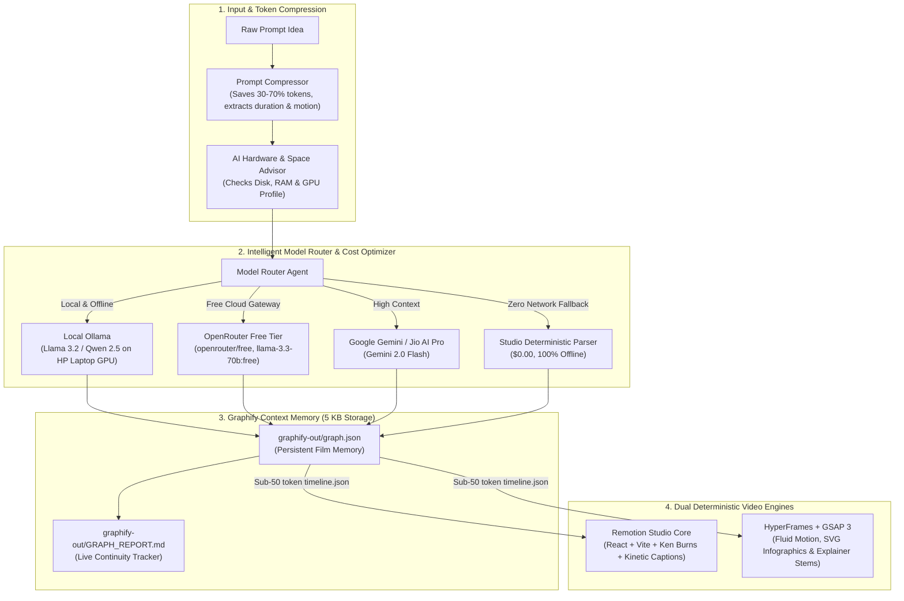

# 🎬 Antigravity Local Video Studio

[](https://opensource.org/licenses/MIT)
[]()
[]()
[]()
[]()
[]()

> **100% Free, Code-Driven AI Documentary & Video Production Studio.**  
> Turn prompts, voiceovers, and research notes into deterministic, broadcast-quality **16:9 Documentaries** and **9:16 Shorts/Reels** using **Remotion, HyperFrames, Graphify Context Memory, and Edge-TTS**.  
> Features an **AI Hardware & Disk Space Advisor**, a **1-Click Quickstart Generator**, an **Intelligent Model Router** with **Local Llama (Ollama) offline fallback**, and **Prompt-Driven Memory Editing**.  
> **Zero Cloud Subscriptions • Zero API Costs • Zero Watermarks • Hardware Accelerated.**

---

## ⚡ 1-Click Quickstart (From Idea to Movie in 1 Command)

Anyone who clones this repository can instantly generate a full 3-act cinematic film from a single sentence prompt:

```bash
python3 scripts/studio.py quickstart "The exploration of Europa ocean beneath the ice"
```

This single command automatically:
1. 🔍 **Scans your hardware:** Checks RAM, free disk space, and GPU compute (NVIDIA CUDA vs. Apple Silicon vs. CPU).
2. 🎬 **Generates a 3-Act Story Arc:** Writes Hook, Journey, and Climax beats.
3. 🎨 **Applies DaVinci Color Science:** Adds 2.39:1 anamorphic cinema bars, 35mm grain, and J-Cut audio leading.
4. 💾 **Stores in Graphify Memory (<6 KB):** Caches the knowledge graph for future zero-token recall.
5. 🚀 **Exports Remotion Timeline:** Prepares `timeline.json` for immediate preview with `npm run preview`.

---

## 🤖 Built-in AI Hardware & Storage Advisor

Before burning tokens or overloading your machine, run the advisor:
```bash
python3 scripts/studio.py advisor
```
* **Disk Space Headroom:** Calculates exact gigabytes available and warns if disk space is low (<1 GB).
* **RAM & CPU/GPU Detection:** Detects NVIDIA RTX/GTX GPUs, Apple M-Series Metal, or Intel CPUs.
* **Auto-Profile Recommendation:**
  * **NVIDIA GPU (e.g. HP Pavilion Gaming):** Recommends **Local GPU Powerhouse** (Fooocus SDXL + Local Ollama Llama 3.2).
  * **Intel Mac (8GB RAM):** Recommends **Cloud-Assisted Mode** (Gemini 2.0 Flash / OpenRouter Free) to keep your machine cool and responsive.

---

## ✏️ Natural Language Memory Editing (Prompt-Driven)

You can edit your film's cached knowledge graph using simple conversational prompts without writing any code:

```bash
# 1. Edit Duration and Camera Motion
python3 scripts/studio.py edit "make scene_01 8.5 seconds and zoom-out"

# 2. Edit Narration / Subtitles
python3 scripts/studio.py edit 'change subtitle of scene_02 to "Neural networks and human vision merged into pure cinema"'

# 3. Switch Global Cinematic Grade Across All Scenes
python3 scripts/studio.py edit "switch global style to netflix-doc"
```

---

## 🌟 The Unified 4-Pillar Architecture



---

## 🚀 All CLI Commands Cheat Sheet

```bash
python3 scripts/studio.py quickstart "<story prompt>"   # 1-Click full film generator
python3 scripts/studio.py advisor                      # Hardware & disk space advisor
python3 scripts/studio.py models                       # Check Ollama, OpenRouter, Gemini status
python3 scripts/studio.py presets                      # List 5 DaVinci film color palettes
python3 scripts/studio.py clean "<noisy prompt>"       # Strip conversational fillers & save tokens
python3 scripts/studio.py edit "<edit command>"        # Natural prompt graph memory editor
python3 scripts/studio.py director-scene <id> "<idea>" # Add scene with DaVinci grade & J-Cut
python3 scripts/studio.py status                       # View live film reel report
python3 scripts/studio.py audio                        # Generate free Microsoft Neural voiceovers
npm run preview                                        # Open in-editor Remotion Player
npm run render                                         # Render final broadcast MP4
```

---

## 📂 Repository Structure

```
antigravity-video-studio/
├── scripts/
│   ├── studio.py                     # Unified master CLI
│   ├── quickstart.py                 # 1-Click full film generator
│   ├── device_advisor.py             # AI hardware & disk space advisor
│   ├── model_router.py               # Prompt compressor & multi-tier router
│   ├── graph_memory.py               # Graphify memory manager
│   ├── graph_editor.py               # Natural language prompt graph editor
│   ├── director_presets.py           # DaVinci LUTs & OpenCut J-Cut presets
│   └── make_voiceovers.py            # Free Edge-TTS audio synthesizer
├── graphify-out/
│   ├── graph.json                    # Persistent film memory graph (~5 KB)
│   └── GRAPH_REPORT.md               # Live film reel & continuity report
├── graphify.config.json              # Graphify memory schema
├── timeline.json                     # Code-ready Remotion timeline recipe
├── remotion.config.ts                # Remotion video configuration
├── packages/
│   └── extension/                    # In-Editor Sidebar Webview (CaldiaWorks Core)
├── src/
│   ├── Root.tsx                      # Remotion composition registry
│   ├── index.ts                      # Remotion root entry
│   ├── types/timeline.ts             # TypeScript definitions
│   └── compositions/
│       ├── DocumentaryComposition.tsx# Master timeline sequencer with J-Cuts
│       ├── CinematicGrade.tsx        # DaVinci 2.39:1 bars, grain & color LUTs
│       ├── KenBurns.tsx              # Cinematic sub-pixel camera motion
│       ├── KineticSubtitle.tsx       # Physics-based spring subtitles
│       └── AudioMixer.tsx            # Auto voice ducking audio mixer
└── README.md                         # Complete studio documentation
```

---

## 📄 License
MIT License. Open-source, royalty-free for personal, educational, and commercial video creation.
