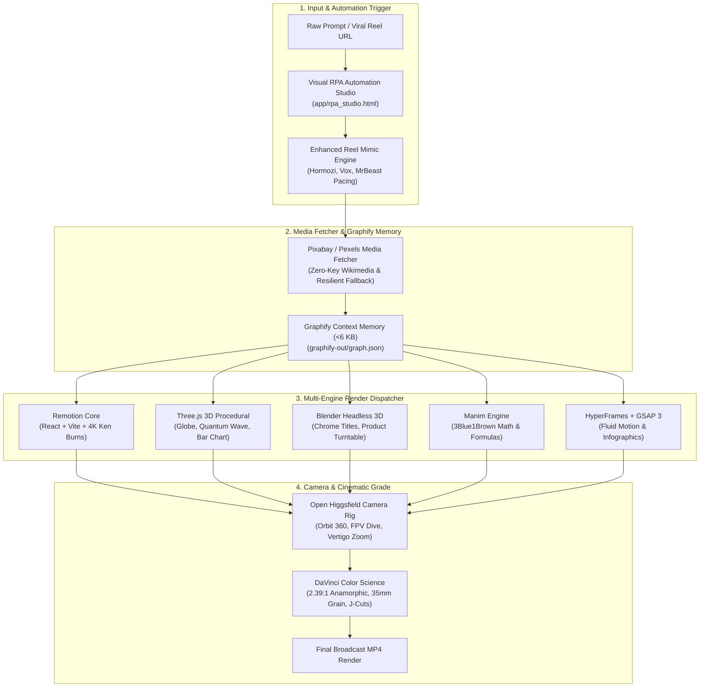
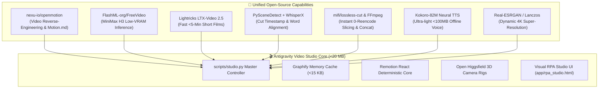

# 🎬 Unified Video Studio Engine & Antigravity AI Studio
### Autonomous Code-Driven AI Video, Documentary & Viral Reel Production Engine

[](https://opensource.org/licenses/MIT)
[](https://github.com/Bakulesh1Codes108/antigravity-video-studio/releases/tag/v1.0.0)
[]()
[]()
[]()
[]()
[]()
[]()
[]()

> **Unified Video Studio Engine (also known as Antigravity Video Studio)**  
> 100% Free, Code-Driven AI Video Production Studio for both **Antigravity AI workflows** and **standalone multi-engine video creation**.  
> Turn prompts, voiceovers, and reference videos into deterministic, broadcast-quality **16:9 Cinema Documentaries** and **9:16 Viral Reels** using **Remotion, Three.js 3D, Blender Headless, Manim Math, Pixabay Media, and Open Higgsfield Camera Rigs**.  
> Features an **Interactive AI Copilot**, **Vertical V3 Safe-Zone Engine**, **Zero-Shot 5-Second Voice Cloning**, **Video Reverse-Engineering (OpenMotion + PySceneDetect)**, **LosslessCut Stream Concat**, and a **Zero-Bloat JIT Engine Hub**.  
> **Zero Subscriptions • Zero API Costs • Zero Watermarks • Hardware Accelerated (macOS & Windows).**

---

## 📘 Comprehensive Free Guide Included (Verified 2026 Edition)

This repository includes the official, full-length verified production handbook:  
* 📄 **[View PDF on GitHub](https://github.com/Bakulesh1Codes108/antigravity-video-studio/blob/main/Antigravity-Video-Free-Guide.pdf)**
* 💾 **[Direct Raw Download (Antigravity-Video-Free-Guide.pdf)](https://raw.githubusercontent.com/Bakulesh1Codes108/antigravity-video-studio/main/Antigravity-Video-Free-Guide.pdf)**
* 🌐 **[Read Online Web Guide (HTML)](./docs/guide.html)**
* ⚡ **Recompile Guide Anytime:** `python3 scripts/studio.py pdf`

*(Covers complete dual-machine setup, Vertical V3 safe zones, 5s voice cloning, 3D rigs, and step-by-step CLI workflows).*

---

## 💡 About This Project & What It Solves

### 🛑 The Problem with Modern AI Video Tools
1. **Expensive Subscriptions & Watermarks:** Most video tools charge \$30–\$100/month for limited credits, low resolutions, and restrictive cloud queues.
2. **Gigabyte Bloatware:** Many open-source AI projects force users to download 50+ GB of heavy checkpoints, instantly overwhelming machines with modest storage (e.g., laptops with 14 GB disk free).
3. **Manual Editing Bottlenecks:** Creators spend hours cutting clips, fixing subtitle safe-zones on TikTok, and manually animating camera moves.

### ⚡ How Antigravity Video Studio Solves It
* **Featherweight Core (&lt;20 MB):** Built on Remotion (React) and Graphify knowledge graphs (&lt;15 KB), keeping your storage free and your machine cool.
* **Deterministic Code Rendering:** 100% frame-accurate animations, audio ducking, and kinetic typography that never drift or jitter.
* **Smart Dual-Machine Architecture:** Lightweight cloud planning on 8GB Mac + GPU-accelerated diffusion & voice cloning on HP Pavilion NVIDIA PC.
* **Multi-Repo Fusion:** Combines Remotion, OpenMotion, FlashML FreeVideo (MiniMax H3), LTX-Video, PySceneDetect, WhisperX, and LosslessCut into a single master CLI.

---

## 🌟 The Unified Multi-Engine Architecture



---

## 📸 Pixabay & Pexels Stock Media Fetcher (Zero-Breakage Guarantee)

The studio automatically acquires royalty-free visual assets for each scene so that Remotion **never fails or shows missing files**:

```bash
# Fetch media on demand for any scene (horizontal or vertical)
python3 scripts/studio.py fetch-media scene_01 "deep space interstellar nebulae" horizontal
```

### Supported Providers:
1. **Pixabay API (`PIXABAY_API_KEY`):** Fetches high-resolution photos and videos across landscape or 9:16 vertical portrait formats.
2. **Pexels API (`PEXELS_API_KEY`):** Alternative stock photo & video catalog.
3. **Wikimedia Commons (Zero Key Needed):** Public domain free media query.
4. **Resilient Local Fail-Safe:** If running offline or without an API key, automatically generates high-contrast visual cards so the video timeline **always renders without breaking**.

To configure your free Pixabay or Pexels API keys:
```bash
export PIXABAY_API_KEY="your_free_pixabay_key"
export PEXELS_API_KEY="your_free_pexels_key"
```

---

## 📱 Vertical V3 Architecture (9:16 Shorts, Reels & TikTok)

The studio includes a dedicated **Vertical V3 engine** engineered specifically for the strict interface constraints and high retention demands of modern vertical video platforms:

```bash
# 1-Click Generate a 9:16 Vertical V3 Reel (Alex Hormozi style pacing)
python3 scripts/studio.py vertical hormozi "How AI is Automating Software Engineering"

# 1-Click Generate a 9:16 Vertical V3 Reel (MrBeast hyper-retention pacing)
python3 scripts/studio.py vertical mrbeast "AI Can Build Any App in 60 Seconds"

# Render the 9:16 Vertical V3 Composition directly to MP4
python3 scripts/studio.py render-vertical
```

### Vertical V3 Features:
* **Platform Safe-Zone Subtitles:** Subtitles are automatically elevated (~32% above bottom) so they are **never obscured** by TikTok/Instagram Reels/Shorts UI overlays (username, caption, sound title, like/comment buttons).
* **Kinetic Word Highlight (Hormozi / MrBeast Style):** Words pop in real-time with vibrant `#FFEE00` neon yellow highlight boxes and bold black text strokes as they are spoken.
* **Smart Blur-Pad Dual Layer:** When horizontal 16:9 images or footage are used in a 9:16 composition, the engine dynamically creates a blurred, saturated ambient background fill behind the sharp, centered foreground visual.
* **Top-Edge Retention Progress Bar:** A smooth gradient progress bar tracks video completion across the top edge to maximize viewer watch-time.
* **Native Composition ID:** Remotion registers both `Documentary` (16:9 1920x1080) and `VerticalV3` (9:16 1080x1920) in [src/Root.tsx](file:///Users/brane/Downloads/aquascape-site/antigravity-video-studio/src/Root.tsx).

---

## 🧬 Enhanced Reel Mimic Engine (Crash-Proof)

The Reel Mimic engine replicates viral pacing while guaranteeing all visual and audio assets exist on disk:
```bash
# 1. Alex Hormozi Style 9:16 Viral Reel (~2.2s cuts, whip pans, high-energy hook)
python3 scripts/studio.py mimic alex_hormozi_viral_reel "How to Start an AI Business in 2026"

# 2. Vox Style 16:9 Explainer (~3.8s cuts, animated maps & data charts)
python3 scripts/studio.py mimic vox_highlighter_explainer "The Geopolitics of Semiconductor Chips"

# 3. MrBeast Style 9:16 Fast Cut (~1.6s cuts, FPV drone dives, retention hooks)
python3 scripts/studio.py mimic mrbeast_retention_hook "Surviving 100 Hours in an AI Studio"

# 4. Netflix Cinematic 16:9 Documentary (~5.5s cuts, 2.39:1 letterbox, slow orbit)
python3 scripts/studio.py mimic netflix_documentary_cinema "The Secret Life of Ancient Oceans"
```

---

## 🎬 Interactive AI Producer Copilot & Step-by-Step Controller

The studio features an intelligent copilot that acts as your executive producer. It asks creative questions when needed, guides story development, and allows you to **execute strictly up to any designated pipeline step on direct command**:

```bash
# 1. Interactive Guided Producer Session (Prompts questions for aspect ratio, pacing, voice)
python3 scripts/studio.py copilot

# 2. Step-by-Step Direct Execution (Executes strictly up to target step, then stops)
python3 scripts/studio.py step script "The Subterranean Oceans of Europa"    # Step 1: Script & token compression only
python3 scripts/studio.py step timeline "Quantum Supercomputing"            # Step 2: Storyboard & Graphify timeline only
python3 scripts/studio.py step media "Ancient Egyptian Astronomy"           # Step 3: Stop after downloading stock visuals
python3 scripts/studio.py step audio "Deep Space Voyagers"                  # Step 4: Stop after voiceover synthesis
python3 scripts/studio.py step preview "Silicon Valley AI Revolution"       # Step 5: Stop when preview player is ready
```

### Pipeline Steps Overview:
| Step | Name | What it Executes |
| :---: | :--- | :--- |
| **1** | `script` | Cleans noisy prompts, strips fillers, compresses tokens, and plans story beats. |
| **2** | `timeline` | Builds story arc, synchronizes Graphify memory nodes, and writes `timeline.json`. |
| **3** | `media` | Automatically queries Pixabay, Pexels, and Wikimedia to ensure all visual assets exist. |
| **4** | `audio` | Synthesizes Microsoft Neural Edge-TTS voiceovers and synchronizes audio timelines. |
| **5** | `preview` | Prepares the deterministic Remotion composition for instant in-editor browser playback. |
| **6** | `render` | Executes the headless Remotion engine to export final broadcast-grade MP4 video. |

---

## 🤖 Visual RPA Automation Studio (`studio.py rpa`)
Launch a node-based Robotic Process Automation (RPA) interface in your browser:
```bash
python3 scripts/studio.py rpa
```
* **Step-by-Step Flow:** Ingestion $\rightarrow$ Reel Mimic $\rightarrow$ Media Fetcher $\rightarrow$ Multi-Engine Dispatcher $\rightarrow$ Higgsfield Camera $\rightarrow$ DaVinci Grade $\rightarrow$ MP4 Export.
* Live console logs, execution progress tracker, and direct render buttons.

---

## 🎥 Open Higgsfield 3D Camera Motion Rigs
Transform static images, 3D scenes, and video layers into cinematic camera moves:
* `orbit_360` — Smooth 3D elliptical revolution around the central subject.
* `fpv_drone_dive` — Dynamic diving camera with banking horizon roll.
* `vertigo_dolly_zoom` — Hitchcock vertigo effect (scaling up while reversing perspective).
* `crane_up_reveal` — Low angle rising to wide panoramic reveal.
* `bullet_time_freeze` — Slow-motion 3D camera sweep.
* `whip_pan` — High-velocity transition snap.

---

## 🌐 Three.js 3D Procedural Scenes (Built-in Remotion)
Generate live interactive 3D elements inside your video without external 3D software:
* `3d_rotating_globe` — Holographic wireframe Earth for geopolitics and travel.
* `3d_quantum_particles` — 3D undulating particle wave for AI and technology.
* `3d_financial_chart` — Isometric 3D animated bar chart with depth.

---

## 🧊 Blender Headless 3D Render Engine
Render photorealistic 3D titles and environments in the background via Blender:
```bash
python3 scripts/studio.py blender 3d_chrome_title "ANTIGRAVITY CINEMA"
```

---

## 📐 Manim Mathematical & Scientific Animation
Create 3Blue1Brown-style formula morphs and neural network animations:
```bash
python3 scripts/studio.py manim neural_network scene_nn_01
```

---

## 📦 The Unified Ecosystem (Combined Repositories & Zero-Bloat JIT Architecture)

Instead of forcing creators to download 50+ GB of model weights or clone dozens of disconnected GitHub repositories, **Antigravity Video Studio unifies the best capabilities of modern open-source video engines into a single lightweight (<20 MB) studio** using an on-demand JIT (Just-In-Time) architecture:



### 🔍 Repository Fusion & Capability Matrix:
| Capability | Original Standalone Repos | Unified in Antigravity Video Studio | Why You Don't Need to Install Separately |
| :--- | :--- | :--- | :--- |
| **Video Reverse-Engineering** | `nexu-io/openmotion`, `PySceneDetect` | `python3 scripts/studio.py reverse-engineer <video.mp4>` | Automatically maps scene cuts & motion rhythms into `timeline.json` without extra wrappers. |
| **Lossless Video Cutting & Concat** | `mifi/lossless-cut` | `python3 scripts/studio.py cut` & `studio.py concat` | Stream copies MP4 files in milliseconds via FFmpeg concat demuxer with zero re-encoding loss. |
| **Short Film Generation (<5 min)** | `Lightricks/LTX-Video`, `FlashML-org/FreeVideo` | `python3 scripts/studio.py advise "short film"` | JIT Engine Hub manages model pipelines on demand without eating 68GB hard drive storage. |
| **Viral 9:16 Kinetic Subtitles** | `WhisperX`, CapCut, Hormozi style | `src/compositions/VerticalV3Subtitle.tsx` | Native word-by-word active pop with platform safe-zone protection inside Remotion. |
| **4K Super-Resolution** | `Real-ESRGAN`, Compact upscalers | `python3 scripts/studio.py upscale <image>` | High-fidelity 4K scaling on demand without keeping giant uncompressed render caches. |
| **Agentic Media Harness** | `slopus/happy`, `bitti-ai/slopus` | `scripts/studio.py copilot` & `app/rpa_studio.html` | Built-in autonomous executive producer copilot and node-based visual RPA canvas. |
| **Media Transform & Asset Server** | `imbo/imbo` | `scripts/media_fetcher.py` | Built-in Pixabay/Pexels/Wikimedia caching with local fail-safe graphic generation. |

---

## 🚀 CLI Commands Cheat Sheet

```bash
# Core Pipeline & AI Copilot
python3 scripts/studio.py copilot                     # Interactive AI executive producer interview
python3 scripts/studio.py step <step> "<topic>"       # Execute strictly up to step: script|timeline|media|audio|preview|render
python3 scripts/studio.py rpa                         # Launch Visual RPA Automation Studio UI
python3 scripts/studio.py quickstart "<story prompt>" # 1-Click 3-act film generator

# Vertical V3 & Viral Reel Mimic
python3 scripts/studio.py vertical [hormozi|mrbeast] "<topic>" # 1-Click 9:16 Vertical V3 viral reel generator
python3 scripts/studio.py convert [16:9|9:16]          # Switch active project between Widescreen & Vertical
python3 scripts/studio.py render-vertical             # Render 9:16 Vertical V3 reel to out/vertical_reel.mp4
python3 scripts/studio.py mimic <preset> "<topic>"    # Clone viral video pacing (Hormozi, Vox, MrBeast)

# Reverse-Engineering, Lossless Cut & Concat
python3 scripts/studio.py reverse-engineer <video>    # OpenMotion + PySceneDetect video clone
python3 scripts/studio.py concat <file1> <file2> ...  # Lossless stream concatenation (0 re-encoding)
python3 scripts/studio.py cut <file> <start> <end>    # Lossless precision cut (LosslessCut pattern)
python3 scripts/studio.py upscale <image_path>        # 4K super-resolution upscaler

# On-Demand Engine Hub & Model Advisor
python3 scripts/studio.py hub                         # View on-demand engine status & JIT install commands
python3 scripts/studio.py advise "<goal>"             # AI stack & model advisor for 5-min films

# Multi-Engine & Audio Tools
python3 scripts/studio.py audio                       # Generate free Microsoft Neural voiceovers
python3 scripts/studio.py clone-voice [sample]        # Clone creator 5s voice for all scenes (NVIDIA GPU / F5-TTS)
python3 scripts/studio.py blender [type] [title]      # Headless 3D Blender render (3d_chrome_title)
python3 scripts/studio.py manim [type] [id]           # 3Blue1Brown math render (neural_network)
python3 scripts/studio.py advisor                     # AI Hardware, RAM & disk space advisor
python3 scripts/studio.py edit "<edit command>"       # Natural prompt graph memory editor
npm run preview                                       # Open in-editor Remotion Player
npm run render                                        # Render final broadcast MP4
```

---

## 💻 Dual-Machine Production Guide

| Feature | On Mac (Intel i5, 8GB) | On HP Pavilion Gaming (NVIDIA GPU) |
| :--- | :--- | :--- |
| **Brain / Scripting** | Gemini Advanced (Jio AI Pro) | Gemini Advanced (Jio AI Pro) |
| **Local LLM Fallback** | Ollama (CPU mode) | **Ollama Llama 3.2 (CUDA GPU accelerated)** |
| **Stock Media Fetching** | Pixabay / Pexels / Wikimedia | Pixabay / Pexels / Wikimedia |
| **3D Blender Renders** | Headless CPU Render | **NVIDIA OptiX / CUDA GPU Accelerated** |
| **Memory Graph** | `scripts/studio.py` | `scripts/studio.py` |
| **Voiceover Engine** | Edge-TTS (Cloud Neural) | Edge-TTS (Cloud Neural) |
| **5-Sec Voice Cloning** | Cloud / CPU Fallback | **F5-TTS / MOSS-TTS (CUDA GPU Accelerated)** |
| **Image Keyframes** | Cloud (Imagen 3 / Pollinations) | **Fooocus Local (CUDA SDXL accelerated)** |
| **Remotion Rendering** | CPU Render | **NVIDIA Hardware Accelerated** |

---

## 📂 Repository Structure

```
antigravity-video-studio/
├── app/
│   ├── rpa_studio.html               # Visual node-based RPA automation UI
│   ├── main.py                       # Cross-platform desktop backend
│   └── ui.html                       # Dark studio GUI interface
├── scripts/
│   ├── studio.py                     # Unified master CLI
│   ├── media_fetcher.py              # Pixabay/Pexels/Wikimedia stock media fetcher
│   ├── rpa_server.py                 # RPA local backend server
│   ├── reel_mimic.py                 # Viral video pacing cloner (Hormozi, Vox, MrBeast)
│   ├── blender_engine.py             # Blender headless 3D render engine
│   ├── manim_engine.py               # Manim math & formula animation dispatcher
│   ├── quickstart.py                 # 1-Click full film generator
│   ├── device_advisor.py             # AI hardware & disk space advisor
│   ├── model_router.py               # Prompt compressor & multi-tier router
│   ├── graph_memory.py               # Graphify memory manager (<6 KB)
│   ├── graph_editor.py               # Natural language prompt graph editor
│   ├── director_presets.py           # DaVinci LUTs & OpenCut J-Cut presets
│   └── make_voiceovers.py            # Free Edge-TTS audio synthesizer
├── src/
│   ├── Root.tsx                      # Remotion composition registry
│   ├── index.ts                      # Remotion root entry
│   ├── types/timeline.ts             # TypeScript definitions
│   └── compositions/
│       ├── DocumentaryComposition.tsx# Master timeline sequencer with J-Cuts
│       ├── HiggsfieldCamera.tsx      # Open Higgsfield 3D camera motion rigs
│       ├── ThreeJsScene.tsx          # 3D procedural scenes (Globe, Quantum, Charts)
│       ├── CinematicGrade.tsx        # DaVinci 2.39:1 bars, grain & color LUTs
│       ├── KenBurns.tsx              # Cinematic sub-pixel camera motion
│       ├── KineticSubtitle.tsx       # Physics-based spring subtitles
│       └── AudioMixer.tsx            # Auto voice ducking audio mixer
├── graphify-out/
│   ├── graph.json                    # Persistent film memory graph (~5 KB)
│   └── GRAPH_REPORT.md               # Live film reel & continuity report
├── timeline.json                     # Code-ready Remotion timeline recipe
├── remotion.config.ts                # Remotion video configuration
├── package.json                      # Remotion & React dependencies
├── tsconfig.json                     # TypeScript compiler configuration
└── README.md                         # Complete studio documentation
```

---

## 📄 License
MIT License. Open-source, royalty-free for personal, educational, and commercial video creation.
