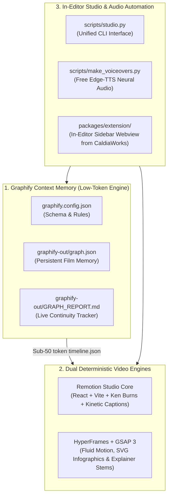

# 🎬 Antigravity Local Video Studio

[](https://opensource.org/licenses/MIT)
[]()
[]()
[]()
[]()
[]()

> **100% Free, Code-Driven AI Documentary & Video Production Studio.**  
> Turn prompts, voiceovers, and research notes into deterministic, broadcast-quality **16:9 Documentaries** and **9:16 Shorts/Reels** using **Remotion, HyperFrames, Graphify Context Memory, and Edge-TTS**.  
> **Zero Cloud Subscriptions • Zero API Costs • Zero Watermarks • Hardware Accelerated.**

---

## 📘 Comprehensive Free Guide Included

This repository comes with the official, full-length guide:  
👉 **[Download: Antigravity-Video-Free-Guide.pdf](./Antigravity-Video-Free-Guide.pdf)** 👈

---

## 🌟 The Unified 3-Pillar Architecture

This studio unites three state-of-the-art open capabilities:



1. **In-Editor Video Engine (`Remotion` from CaldiaWorks)**:
   - Live timeline player embedded directly in VS Code / Antigravity IDE (`packages/extension/`).
   - Programmatic MP4 rendering with Ken Burns zoom, kinetic subtitles, and auto audio ducking.
2. **Context Memory Layer (`Graphify`)**:
   - `graphify-out/graph.json` keeps track of characters, scenes, visual style guides, and audio paths.
   - Reduces LLM token usage by **90%+** using ultra-compact context summaries.
3. **Autonomous Asset Generation (`Edge-TTS + Local AI Director`)**:
   - Free Microsoft Neural voiceover synthesis (`scripts/make_voiceovers.py`).
   - Automated timeline calculations that sync visual frames to speech length.

---

## 🚀 Quick Start (Autonomous Studio CLI)

### 1. Check Project Memory Status
```bash
python3 scripts/studio.py status
```

### 2. Add or Update a Scene (Sub-50 Token Action)
```bash
python3 scripts/studio.py add-scene scene_01 "The Spark" "For centuries, creation was strictly human. In 2026, everything changed." 5 "Cinematic wide shot of futuristic server room, volumetric blue lighting, 35mm lens" "zoom-in"
```

### 3. Generate Free Studio Voiceovers
```bash
python3 scripts/studio.py audio
```

### 4. Preview in Remotion
```bash
npm install
npm run preview
```

### 5. Render Final 4K/1080p MP4
```bash
npm run render
```

---

## 💻 Dual-Machine Production Guide

| Feature | On Mac (Intel i5, 8GB) | On HP Pavilion Gaming (NVIDIA GPU) |
| :--- | :--- | :--- |
| **Brain / Scripting** | Gemini Advanced (Jio AI Pro) | Gemini Advanced (Jio AI Pro) |
| **Memory Graph** | `scripts/studio.py` | `scripts/studio.py` |
| **Voiceover Engine** | Edge-TTS (Cloud Neural) | Edge-TTS (Cloud Neural) |
| **Image Keyframes** | Cloud (Imagen 3 / Pollinations) | **Fooocus Local (CUDA accelerated)** |
| **Remotion Rendering** | CPU Render | **NVIDIA Hardware Accelerated** |

---

## 📂 Repository Structure

```
antigravity-video-studio/
├── Antigravity-Video-Free-Guide.pdf   # Complete official user guide (PDF)
├── graphify-out/
│   ├── graph.json                    # Persistent film memory graph
│   └── GRAPH_REPORT.md               # Live film reel & continuity report
├── graphify.config.json              # Graphify memory schema
├── timeline.json                     # Code-ready Remotion timeline recipe
├── remotion.config.ts                # Remotion video configuration
├── packages/
│   └── extension/                    # In-Editor Sidebar Webview (CaldiaWorks Core)
├── src/
│   ├── Root.tsx                      # Remotion composition registry
│   ├── index.ts                      # Remotion root entry
│   ├── types/timeline.ts             # TypeScript definitions
│   └── compositions/
│       ├── DocumentaryComposition.tsx# Master timeline sequencer
│       ├── KenBurns.tsx              # Cinematic sub-pixel camera motion
│       ├── KineticSubtitle.tsx       # Physics-based spring subtitles
│       └── AudioMixer.tsx            # Auto voice ducking audio mixer
├── scripts/
│   ├── studio.py                     # Unified master CLI
│   ├── graph_memory.py               # Graphify memory manager
│   ├── make_voiceovers.py            # Free Edge-TTS audio synthesizer
│   ├── local_ai_director.py          # Bridge to local Ollama/Qwen/Llama models
│   ├── extract_vocals.py             # Demucs stem separator
│   └── transcribe_sync.py            # Whisper.cpp millisecond timestamp extractor
├── app/
│   ├── main.py                       # Cross-platform desktop backend
│   └── ui.html                       # Dark studio GUI interface
├── templates/
│   ├── lyric-video/                  # Base 9:16 GSAP template
│   └── nikhil-kamath-wtf-infographics/# Podcast infographic explainer template
├── examples/                         # Production showcase MP4 files
├── setup.sh                          # macOS setup script
├── setup.bat                         # Windows batch installer
└── README.md                         # Unified studio documentation
```

---

## 📄 License
MIT License. Open-source, royalty-free for personal, educational, and commercial video creation.
